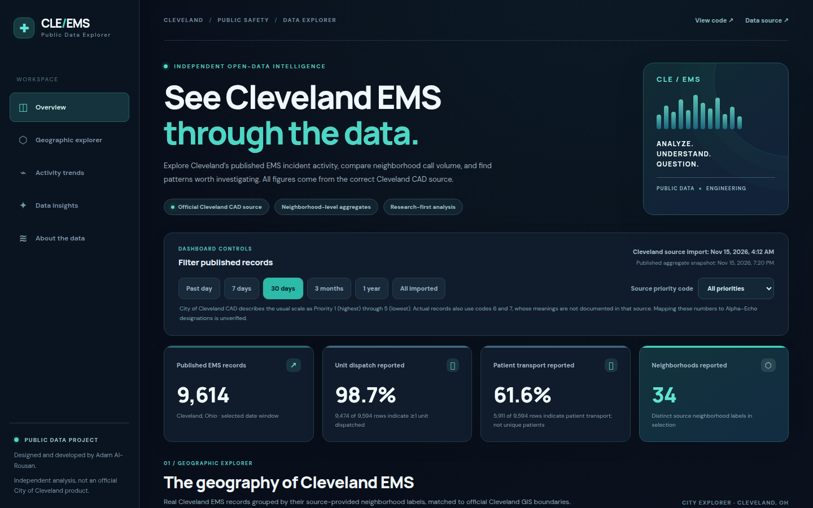
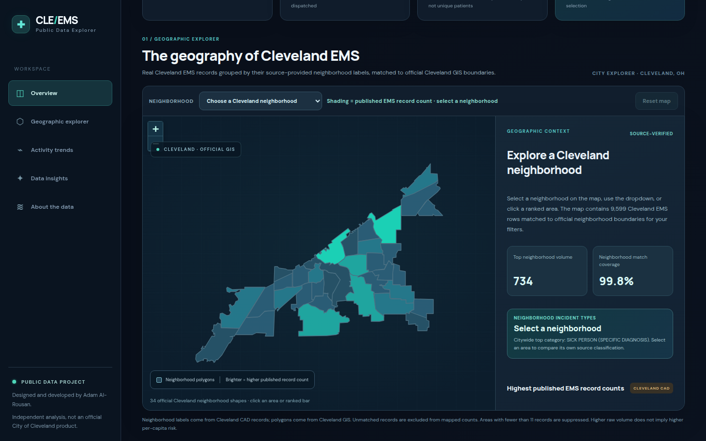

# Cleveland EMS Analytics

**A source-verified, interactive public-data explorer of emergency medical services activity in Cleveland, Ohio.**

[Explore the v6 preview](https://dashboard-v6-real-cleveland.cleveland-ems-explorer.pages.dev/) · [Official City of Cleveland dataset](https://www.arcgis.com/home/item.html?id=d5d71757cc73400d843c98bcb46e46b6) · [Source code and setup](webapp/) · [GitHub Actions](https://github.com/Rousan21/cleveland-ems-analytics/actions)



*Verified browser screenshot of the v6 dashboard's introduction, filters, and source-based KPIs (November 15, 2026).*



*The interactive geographic explorer: Cleveland neighborhoods shaded by published EMS record volume, with rankings and geographic match coverage.*

> **Release status:** v6 is currently in [Pull Request #10](https://github.com/Rousan21/cleveland-ems-analytics/pull/10). It has passed automated and browser tests but **has not been merged into `main`**. The production URL may still display an older prototype that used an incorrect Virginia Beach source. Do not interpret earlier production statistics as Cleveland findings.

## Why this project exists

Public emergency-services records can help answer **where activity is concentrated, which situations are commonly recorded, and when activity occurs**. But raw counts can easily mislead: the source city, geographic labels, publication timing, and record definitions all matter.

I built Cleveland EMS Analytics as a practical, end-to-end data project: from public ArcGIS ingestion and PostgreSQL storage to interactive geographic exploration, evidence-led charts, and explicit uncertainty.

## What you can explore

| Question | What the dashboard shows |
| --- | --- |
| **Where is published activity concentrated?** | Cleveland neighborhood choropleth, top-ten list, selected area counts, geographic match coverage and privacy-aware category insight |
| **What kinds of calls appear most often?** | Top-eight recorded **dispatch classifications**, shown as readable horizontal bars with counts and shares of all selected records |
| **When are calls recorded?** | A complete-local-day trend and hour-of-day distribution |
| **Are patients transported or units dispatched?** | Source-based transport and dispatch indicator percentages calculated only among known values |
| **How do filters affect the data?** | Six preset date windows, Cleveland priority codes 1–7, and aggregate-only daily CSV export |


*The citywide incident-type chart responds to date and priority filters. Selecting a neighborhood instead updates the map's geographic detail, not the citywide charts. Labels reflect dispatch-time classifications, **not medical diagnoses**.*

## Source, integrity and definitions

- **Authoritative source:** City of Cleveland, Ohio, [`CAD_EMS_Public` ArcGIS table](https://services3.arcgis.com/dty2kHktVXHrqO8i/ArcGIS/rest/services/data/FeatureServer/0), item `d5d71757cc73400d843c98bcb46e46b6`. Imports reject rows whose `city` field is not Cleveland and check expected source fields before writing.
- **Published records ≠ unique emergencies:** one row is not independently verified as one incident or patient. Counts are descriptive, not a measure of incidence, ambulance demand, or response performance.
- **Geography:** source-provided neighborhood labels are matched case-insensitively to official Cleveland GIS polygons. Unmatched records are excluded from mapped counts, match coverage is published, and area/category cells below **11** are withheld.
- **Incident classifications:** `IncidentTypeDescription` reflects the situation as understood at dispatch time; it is not a confirmed diagnosis.
- **Dispatch and transport:** the City's field metadata defines `isDispatch=true` as one or more units dispatched, and `isTransport=true` as an incident resulting in patient transport. Neither gives the number of unique patients, units, hospital admissions, or a response-time measurement.
- **Priorities:** City metadata describes a usual priority ranking from 1 (highest) to 5 (lowest); the live source also contains codes 6 and 7, whose precise meaning and Alpha–Echo correspondence are unverified.
- **Publication dates:** a rolling window begins mid-day. Partial boundary dates are excluded from the **comparative daily chart** but retained in headline totals and CSV. Even complete older dates may later be revised.

## Architecture

```text
        City of Cleveland ArcGIS CAD_EMS_Public
                         │
              Schema + city validation
                         │
              Python incremental importer
                  ObjectId upserts
                         │
                Neon PostgreSQL
           cleveland_ems_records
                         │
          Python aggregate & area summaries
                  │               │
     Official Cleveland     6 date windows ×
     neighborhood polygons  8 priority choices
                  │               │
                  └───────┬───────┘
                          ▼
            Privacy-thresholded JSON
                          │
                   Cloudflare Pages
            Leaflet map · category bars
             daily/hourly charts · CSV

     GitHub Actions = tests + source QA + scheduled sync
     FastAPI = optional Cleveland-only aggregate API
```

**Stack:** Python 3.12, SQLAlchemy, PostgreSQL/Neon, FastAPI, GitHub Actions, Cloudflare Pages, JavaScript, Chart.js, Leaflet and ArcGIS REST.

Static builds precompute **48 date/priority selections** to avoid repeated database queries on each click. The browser receives aggregates and public neighborhood polygons—no individual EMS records, patient addresses, source incident IDs, or database secrets.

## Engineering decisions and lessons

**Fixing source provenance.** An audit exposed that a previous prototype had unintentionally used **Virginia Beach, Virginia** EMS data. I replaced its source with Cleveland's official feed, added independent Cleveland tables, and introduced checks that prevent incompatible data from being published. The old database records remain isolated for historical testing.

**Removing misleading trends.** Partial first/current days created apparent dramatic declines in a rolling 30-day graph. The dashboard now plots comparable complete Cleveland-local dates while disclosing excluded dates and preserving full-period totals.

**Making the map robust.** The interface uses verified neighborhood labels and polygons, displays match coverage, suppresses small-area cells, and is tested in a real browser. Serving Leaflet styles locally also resolved a real CSS/CDN issue that distorted the map.

**Choosing useful metrics.** Unsupported legacy response-time medians and a lower-value priority doughnut were removed. The interface now prioritizes **where, what, and when**, including the leading source incident classifications.

## Run it locally

```bash
git clone https://github.com/Rousan21/cleveland-ems-analytics.git
cd cleveland-ems-analytics
git switch dashboard-v6-real-cleveland-data  # until PR #10 is merged
cd webapp
python3 -m venv .venv
source .venv/bin/activate
pip install -r requirements.txt
python cleveland_pipeline.py sync --days 30
uvicorn main:app --reload
```

Open `http://127.0.0.1:8000` or `http://127.0.0.1:8000/docs`. A local SQLite DB works without credentials; set `EMS_DATABASE_URL` to use your own Neon PostgreSQL database. See [webapp/README.md](webapp/README.md) for detailed commands. Import a longer history to populate the year/all-imported presets.

```bash
pytest -q
node --check static/dashboard.js
node --check static/v6.js
python audit_cleveland_source.py
python audit_map_geometry.py
```

CI additionally runs a headless Chrome check for desktop/mobile map sizing, geographic interaction, daily-chart boundaries and recorded-category rendering.

## Next improvements

Rather than adding more charts or neighborhood comparisons, the most useful next work is **automatic data-quality alerts**, **a concise filter-aware “What the data reveals” narrative**, **a short first-time visitor walkthrough**, and **measured load-speed/deployment-reliability results**. Those would make the existing analysis more trustworthy and easier to explain.

---

**Independently designed and developed by Adam Al-Rousan.** Not affiliated with or endorsed by the City of Cleveland or its EMS division. Exploratory public-data analysis, not a live dispatch monitor or a basis for emergency-resource deployment.
